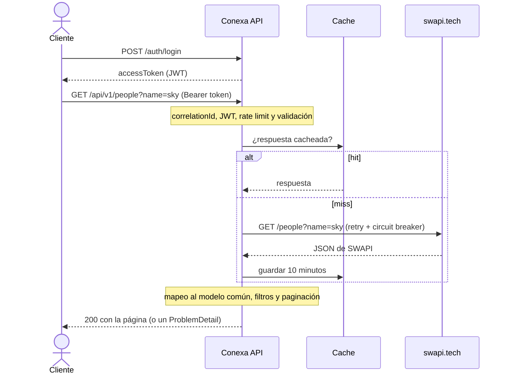
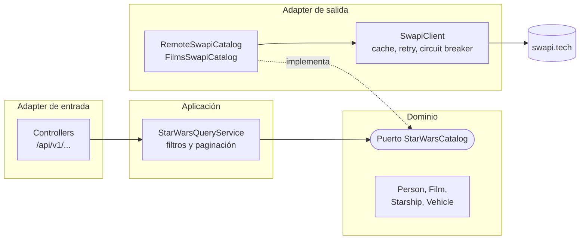

# Conexa Star Wars API

API REST en **Java 21 + Spring Boot 4** que expone **People, Films, Starships y Vehicles** de Star Wars a partir de [swapi.tech](https://www.swapi.tech), con paginación, filtros por id y/o nombre y autenticación JWT.

## Qué hace

Es una capa entre tus clientes y SWAPI que agrega:

- **Contrato estable y versionado** (`/api/v1`): los 4 recursos responden con el mismo formato, en camelCase y con los mismos nombres (SWAPI mezcla `title` y `name`, usa snake_case y tiene un typo en `max_atmosphering_speed`).
- **Paginación y filtros** por `id` y/o `name`, combinables.
- **Autenticación**: registro, login y JWT en todas las rutas de negocio.
- **Cache** de las respuestas de SWAPI (10 minutos): respuestas rápidas y menos consumo del límite de SWAPI.
- **Resiliencia**: reintentos ante fallas transitorias y circuit breaker cuando SWAPI está caído.
- **Rate limit** por usuario y por IP.
- **Errores uniformes** en formato [`ProblemDetail`](https://www.rfc-editor.org/rfc/rfc9457) con un `correlationId` para rastrearlos.
- **Documentación** interactiva con Swagger.

## Cómo integrarse

Los ejemplos usan `http://localhost:8080`; ver [Cómo correrlo](#cómo-correrlo).

### 1. Registrarse

```bash
curl -X POST http://localhost:8080/auth/register \
  -H 'Content-Type: application/json' \
  -d '{"username": "luke", "password": "skywalker123"}'
```

`201 Created` → `{"id": "…", "username": "luke"}`

- `username`: 3 a 50 caracteres (letras, números, `.`, `_` o `-`).
- `password`: 8 a 72 caracteres ASCII imprimibles (sin acentos ni emojis).

### 2. Obtener el token

```bash
curl -X POST http://localhost:8080/auth/login \
  -H 'Content-Type: application/json' \
  -d '{"username": "luke", "password": "skywalker123"}'
```

```json
{ "accessToken": "eyJhbGciOiJIUzI1NiJ9…", "tokenType": "Bearer", "expiresIn": 3600 }
```

El token vence a la hora (`expiresIn`, en segundos). Al vencer, se vuelve a hacer login.

### 3. Consultar los recursos

Enviar el token en el header `Authorization`:

```bash
curl http://localhost:8080/api/v1/people?size=2 \
  -H "Authorization: Bearer $TOKEN"
```

```json
{
  "content": [
    { "id": 1, "name": "Luke Skywalker", "gender": "male", "birthYear": "19BBY", "height": "172",
      "mass": "77", "hairColor": "blond", "skinColor": "fair", "eyeColor": "blue" },
    { "id": 2, "name": "C-3PO", "gender": "n/a", "birthYear": "112BBY", "height": "167",
      "mass": "75", "hairColor": "n/a", "skinColor": "gold", "eyeColor": "yellow" }
  ],
  "page": 1,
  "size": 2,
  "totalElements": 82,
  "totalPages": 41
}
```

| Endpoint | Recurso |
|---|---|
| `GET /api/v1/people` | Personajes |
| `GET /api/v1/films` | Películas (episodios I a VI) |
| `GET /api/v1/starships` | Naves con hiperimpulsor |
| `GET /api/v1/vehicles` | Vehículos sin hiperimpulsor |

### 4. Paginar y filtrar

| Parámetro | Default | Descripción |
|---|---|---|
| `page` | 1 | Número de página, desde 1 (máximo 10000) |
| `size` | 10 | Elementos por página (1 a 50) |
| `id` | — | Filtra por id |
| `name` | — | Filtra por nombre: coincidencia parcial, sin distinguir mayúsculas (hasta 100 caracteres) |

```bash
curl -H "Authorization: Bearer $TOKEN" "http://localhost:8080/api/v1/films?name=jedi"
curl -H "Authorization: Bearer $TOKEN" "http://localhost:8080/api/v1/starships?id=10&name=falcon"
```

- `id` y `name` se combinan: el resultado tiene que cumplir los dos.
- **Sin resultados no es un error:** un id inexistente, un id y un nombre que no coinciden o una página fuera de rango responden `200` con `content` vacío.

### 5. Manejar errores

Todos los errores responden `application/problem+json`:

```json
{
  "type": "about:blank",
  "title": "Bad Request",
  "status": 400,
  "detail": "Invalid request content.",
  "errors": { "size": "must be between 1 and 50" },
  "correlationId": "5f0c6a8e-3c1d-4f7a-9b2e-1d4c8a7e6b10"
}
```

| Status | Cuándo | Qué hacer |
|---|---|---|
| `400` | Parámetros o body inválidos (`errors` indica cada campo) | Corregir el request; no reintentar igual |
| `401` | Falta el token, es inválido o venció; o credenciales incorrectas en el login | Hacer login de nuevo |
| `409` | El username ya existe (registro) | Elegir otro username |
| `429` | Se superó el rate limit | Esperar los segundos de `Retry-After` |
| `502` | SWAPI falló o respondió algo inválido | Reintentar más tarde |
| `503` | SWAPI limitó las llamadas o está fallando repetidamente | Esperar los segundos de `Retry-After` |
| `504` | SWAPI no respondió a tiempo | Reintentar más tarde |
| `500` | Error inesperado | Reportarlo con el `correlationId` |

**`correlationId`:** cada respuesta trae el header `X-Correlation-Id` (también en el body de los errores). Podés enviar el tuyo en ese header (letras, números y `-`, hasta 64 caracteres) para seguir la request en los logs.

### 6. Rate limit

| Rutas | Límite | Por |
|---|---|---|
| `/auth/**` | 10 requests por minuto | IP |
| `/api/**` | 120 requests cada 15 minutos | Usuario |

El límite de `/api/**` acompaña al de SWAPI (100 requests cada 15 minutos) con un margen para los requests que nunca le llegan (errores de validación y respuestas desde la cache).

### 7. Swagger

Con la app corriendo: **http://localhost:8080/swagger-ui.html**

Registrate y logueate desde la sección **Auth**, pegá el `accessToken` en **Authorize** y probá los endpoints desde el navegador.

## Cómo funciona

### Flujo de una request



### Arquitectura

Hexagonal pragmática: el dominio no depende de Spring ni de SWAPI, y SWAPI se accede a través de un puerto de salida.



```
com.conexa.challenge
├── domain/                       # modelos, puertos de salida y excepciones; sin frameworks
├── application/service/          # casos de uso
└── infrastructure/
    ├── adapter/in/web/           # controllers, validación, errores HTTP, correlationId
    ├── adapter/out/swapi/        # cliente de SWAPI, catálogos, DTOs y mapeo al dominio
    ├── adapter/out/persistence/  # usuarios en memoria
    ├── security/                 # registro, login, JWT y rate limit
    └── config/                   # wiring y OpenAPI
```

### Decisiones clave

- **Un endpoint por recurso, filtros por query params.** El path identifica la colección; `page`, `size`, `id` y `name` la filtran y paginan con un único contrato.
- **Objetos completos en el listado** (`expanded=true` en SWAPI): una sola forma de respuesta por recurso.
- **Paginación delegada a SWAPI** donde la soporta; en memoria solo donde SWAPI no pagina (búsqueda por nombre y Films).
- **Particularidades de SWAPI resueltas en el adapter**: una página fuera de rango devuelve la última (se descarta), la búsqueda por nombre es una regex de MongoDB (se escapan los caracteres especiales) y los nombres se normalizan en el mapeo.
- **Errores de SWAPI traducidos a dominio** en un solo lugar (`SwapiErrorTranslator`); el status HTTP lo decide el advice.
- **Resiliencia**: solo se reintentan fallas transitorias (conexión y 5xx), no los timeouts, los 429 ni las respuestas inválidas. El circuit breaker se abre si falla la mitad de las últimas 20 llamadas y responde 503 durante 30 s sin llamar a SWAPI.
- **Cache por fuera de la resiliencia**: un hit no pasa por retry ni circuito. Las fallas no se cachean.
- **Usuarios en memoria** detrás de un puerto: sin base de datos para el alcance del challenge; se reemplaza con otro adapter sin tocar el resto.
- **Virtual threads** (Java 21): un SWAPI lento no agota los hilos del servidor.

## Cómo correrlo

### Con Java 21

```bash
./mvnw spring-boot:run          # Windows: mvnw.cmd spring-boot:run
```

### Con Docker

```bash
docker build -t conexa-challenge .
docker run -p 8080:8080 conexa-challenge
```

En ambos casos la API queda en `http://localhost:8080` y el health check en `/actuator/health`.

## Configuración

Todo se configura con variables de entorno; ninguna es obligatoria.

| Variable | Default | Descripción |
|---|---|---|
| `SERVER_PORT` | `8080` | Puerto HTTP |
| `JWT_SECRET` | aleatorio | Clave de firma de los JWT (mínimo 32 caracteres). Ver abajo |
| `JWT_EXPIRATION` | `1h` | Vigencia del token |
| `SWAPI_BASE_URL` | `https://www.swapi.tech/api` | URL de SWAPI |
| `SWAPI_CONNECT_TIMEOUT` | `3s` | Timeout de conexión a SWAPI |
| `SWAPI_READ_TIMEOUT` | `10s` | Timeout de respuesta de SWAPI (holgado por su demora progresiva) |
| `SWAPI_CACHE_TTL` | `10m` | Tiempo que se cachea cada respuesta de SWAPI |
| `SWAPI_RETRY_MAX_ATTEMPTS` | `3` | Intentos por llamada (1 + reintentos) |
| `SWAPI_RETRY_INITIAL_BACKOFF` | `200ms` | Espera antes del primer reintento (crece exponencialmente) |
| `SWAPI_CIRCUIT_WINDOW_SIZE` | `20` | Llamadas que evalúa el circuit breaker |
| `SWAPI_CIRCUIT_MINIMUM_CALLS` | `10` | Llamadas mínimas antes de poder abrir el circuito |
| `SWAPI_CIRCUIT_FAILURE_RATE` | `50` | Porcentaje de fallas que abre el circuito |
| `SWAPI_CIRCUIT_OPEN_DURATION` | `30s` | Tiempo que el circuito queda abierto |
| `RATE_LIMIT_AUTH_LIMIT` / `RATE_LIMIT_AUTH_PERIOD` | `10` / `1m` | Límite de `/auth/**` por IP |
| `RATE_LIMIT_API_LIMIT` / `RATE_LIMIT_API_PERIOD` | `120` / `15m` | Límite de `/api/**` por usuario |

**`JWT_SECRET`:** si no se define, la app genera una clave aleatoria al arrancar y lo avisa en el log. Alcanza para probarla, pero los tokens dejan de valer al reiniciar. En un entorno real la clave vive en un gestor de secretos (AWS Secrets Manager, Vault, Kubernetes Secret o los secrets del pipeline) y se inyecta como variable de entorno: `docker run -e JWT_SECRET=… conexa-challenge`.

## Tests

```bash
./mvnw verify
```

- **Unitarios:** reglas de filtrado y paginación, traducción de errores, mapeo de errores a HTTP y el filtro de `correlationId`.
- **Adapter con WireMock:** respuestas reales de SWAPI como fixtures, cada falla posible, reintentos y circuit breaker.
- **End-to-end (MockMvc + WireMock):** token → endpoint → JSON, validaciones, errores, cache, rate limit, health y correlationId.
- **Contrato de OpenAPI:** verifica que la documentación publicada coincida con la API.

Reporte de cobertura (JaCoCo): `target/site/jacoco/index.html`.

## Limitaciones conocidas

- **Usuarios y rate limit en memoria:** se pierden al reiniciar y valen para una sola instancia. Con varias instancias harían falta una base de datos y un store compartido (por ejemplo Redis).
- **El cupo de SWAPI es compartido:** todas las llamadas salen desde la IP del servidor, así que las 100 requests cada 15 minutos de SWAPI son para todos los usuarios juntos. Lo amortiguan la cache, el circuit breaker y el `503` con `Retry-After`.
- **Rate limit por IP detrás de un proxy:** se usa la IP de la conexión. Si se despliega detrás de un proxy, hay que configurar `server.forward-headers-strategy` solo si el proxy es confiable (si no, `X-Forwarded-For` se podría falsear).
- **Timeout leyendo el body:** si SWAPI deja de responder después de enviar los headers, el cliente HTTP del JDK no lo informa como timeout y la respuesta es `502` en lugar de `504`.
